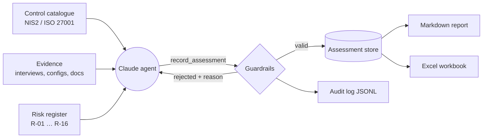

# AI GRC Gap-Analysis Agent

An **AI agent that performs a compliance gap analysis** of an organisation against **NIS2** or **ISO/IEC 27001:2022**, built with the [Claude Agent SDK](https://github.com/anthropics/claude-agent-sdk-python) for Python.

The agent reads the organisation's evidence (interview notes, configuration exports, policies), assesses every control, links each gap to the risk register and produces a prioritised report and an Excel workbook — with **guardrails that stop it from inventing evidence** and a full **audit trail** of every action.

>  **Why this project?** I'm focused on cybersecurity governance and GRC. Gap analyses are slow, repetitive and evidence-heavy — a good fit for AI assistance, *if* the output stays traceable and a human stays accountable. This project explores where AI genuinely helps a GRC analyst, and where it must not be trusted blindly.

> The organisation (**CloudNova**) and all evidence are **fictional**. It's the same company as my [ISO 27005 risk register](https://github.com/bibi-mateo55/iso27005-risk-register) project.

---

## What it does



1. The agent lists every control in scope and searches the evidence for each one.
2. It records a structured judgement per control: status, cited evidence, rationale, gap, recommendation, priority, confidence and related risks.
3. Every judgement passes **validation guardrails**; invalid ones are rejected with the reason, and the agent corrects itself.
4. A **coverage check** confirms that no control was skipped.
5. Outputs: a prioritised gap report (Markdown), an Excel workbook and an audit log.

---

## Guardrails — the important part

Using AI in compliance is risky: a confident, made-up finding is worse than no finding. The agent is designed so that its output stays **traceable, verifiable and reviewable**:

| Risk with AI in GRC | Control built into this agent |
|---|---|
| Hallucinated evidence | Only evidence IDs that exist can be cited; unknown IDs are rejected |
| "Implemented" without proof | A control can't be marked (partially) implemented without supporting evidence |
| Invented controls or risks | Control and risk IDs are validated against the catalogue and the risk register |
| Vague output | Gaps require a concrete recommendation and a priority |
| Skipped controls | Coverage check — the report flags any control left unassessed |
| Overconfidence | Anything below *high* confidence is flagged for human review 🔍 |
| Excessive agency | **Least privilege:** the agent has no shell, file or web access — only 6 read/record tools |
| Runaway cost | Hard spending cap (`--max-budget`) and turn limit |
| No accountability | Every tool call is written to a JSONL **audit log** |
| Automation bias | Every report is labelled as an AI-assisted draft that a human must validate |

These guardrails are covered by offline tests (`tests/test_guardrails.py`).

---

## Sample output

See [`examples/sample_run/`](examples/sample_run/):

- [`gap_analysis_nis2.md`](examples/sample_run/gap_analysis_nis2.md) — prioritised gap report
- [`gap_analysis_nis2.xlsx`](examples/sample_run/gap_analysis_nis2.xlsx) — workbook (gap analysis, summary, evidence)
- [`audit_log_nis2.jsonl`](examples/sample_run/audit_log_nis2.jsonl) — audit trail

> **Transparency note:** the sample assessments were **hand-written** to illustrate the output format, then replayed through the same tools and guardrails with `--offline-demo`. They were **not** produced by a live AI run. Run the agent yourself (below) to generate a live report.

Sample result for CloudNova vs NIS2: **12/12 requirements assessed, 0 implemented, 6 partial, 6 not implemented — compliance score 25%.** Top gaps: no incident response or NIS2 reporting process, no MFA on the cloud root account, and no management-body oversight.

---

## Run it

Requires **Python 3.10+**. The Claude Agent SDK bundles the Claude Code CLI, so nothing else is needed.

```bash
git clone https://github.com/bibi-mateo55/ai-grc-gap-agent.git
cd ai-grc-gap-agent
python3 -m venv .venv && source .venv/bin/activate
pip install -r requirements.txt
```

**Offline demo (no API key, no cost):**

```bash
python -m gap_agent --framework nis2 --offline-demo
```

**Live agent run** (needs an [Anthropic API key](https://console.anthropic.com/)):

```bash
export ANTHROPIC_API_KEY=sk-ant-...
python -m gap_agent --framework nis2 --model sonnet --max-budget 3
python -m gap_agent --framework iso27001 --model sonnet --max-budget 5
```

Outputs go to `./output/`. Options: `--framework {nis2,iso27001}`, `--model`, `--max-budget` (USD cap), `--max-turns`, `--out`.

**Tests:**

```bash
pip install pytest && python -m pytest -q
```

---

## Project structure

```
gap_agent/
├── agent.py     # CLI, system prompt, agent loop (ClaudeSDKClient)
├── tools.py     # 6 custom tools exposed via an in-process MCP server
├── store.py     # assessment store, validation guardrails, audit log, scoring
├── catalog.py   # loads controls, evidence and risks; transparent keyword search
└── report.py    # Markdown + Excel output
data/
├── controls_nis2.json         # NIS2 Art. 20, 21(2)(a)–(j), 23 — paraphrased
├── controls_iso27001.json     # 27 selected Annex A controls (2022)
├── cloudnova_evidence.json    # 24 fictional evidence items
└── cloudnova_risks.json       # risk IDs from the ISO 27005 register
examples/sample_run/           # sample outputs
tests/test_guardrails.py       # offline tests
```

**Agent tools:** `list_controls`, `list_evidence_areas`, `search_evidence`, `get_risks`, `record_assessment`, `get_progress`.

---

##  Cross-framework mapping

Each NIS2 requirement lists related ISO 27001 controls (e.g. NIS2 Art. 21(2)(j) MFA → ISO 27001 5.17, 8.5), so an organisation that already works towards ISO 27001 can reuse that work for NIS2.

---

## Limitations — what AI should *not* do here

- **It does not replace an auditor.** It drafts; a qualified person validates, especially anything flagged 🔍.
- **It's only as good as the evidence.** Missing or outdated evidence leads to wrong conclusions; real assessments need interviews and sampling.
- **Requirements are paraphrased**, not the legal or ISO text. Always check the official NIS2 Directive, the national transposition law and the licensed ISO standard.
- **Keyword search is basic** by design (transparent and explainable). A larger evidence base would need better retrieval.
- **Data protection:** sending real company evidence to an external AI provider requires a data-processing review first.

---


---

*Portfolio project by Mateo — MSc Crisis and Security Management (Leiden University).*
